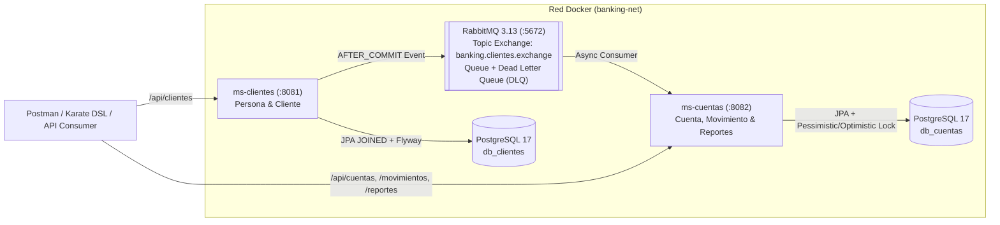

# Core Banking Microservices — Arquitectura Hexagonal

Solución empresarial de **Microservicios Bancarios** desarrollada en **Java 21 LTS + Spring Boot 3.5**, aplicando **Arquitectura Hexagonal (Ports & Adapters)**, **Clean Architecture**, principios **SOLID**, **GRASP (Alta Cohesión y Bajo Acoplamiento)** y comunicación asíncrona resiliente mediante **RabbitMQ**.

---

## Tabla de Contenido

1. [Resumen de Cumplimiento Funcional (F1 – F7)](#1-resumen-de-cumplimiento-funcional-f1--f7)
2. [Arquitectura de Microservicios y Comunicación Asíncrona](#2-arquitectura-de-microservicios-y-comunicación-asíncrona)
3. [Estructura del Proyecto (Monorepo Multi-Módulo)](#3-estructura-del-proyecto-monorepo-multi-módulo)
4. [Despliegue Rápido con Docker Compose (F7)](#4-despliegue-rápido-con-docker-compose-f7)
5. [Ejecución de Pruebas Unitarias, Integración y Karate DSL (F5 & F6)](#5-ejecución-de-pruebas-unitarias-integración-y-karate-dsl-f5--f6)
6. [Referencia de Endpoints REST](#6-referencia-de-endpoints-rest)
7. [Factores No Funcionales: Rendimiento, Escalabilidad y Resiliencia](#7-factores-no-funcionales-rendimiento-escalabilidad-y-resiliencia)
8. [Entregables Incluidos](#8-entregables-incluidos)

---

## 1. Resumen de Cumplimiento Funcional (F1 – F7)

| Código | Requerimiento | Estado | Implementación Destacada |
| :--- | :--- | :---: | :--- |
| **F1** | CRUD de `Cliente` (`/clientes`) y CRU de `Cuenta` (`/cuentas`) y `Movimiento` (`/movimientos`) | ✅ Cumplido | Doble mapeo `/api/...` y `/...` para máxima compatibilidad; herencia `Cliente extends Persona` (`InheritanceType.JOINED`); contraseñas cifradas con `BCrypt`. |
| **F2** | Registro de movimientos (+/-), actualización de saldo disponible e historial transaccional | ✅ Cumplido | Precisión monetaria `BigDecimal(19,2)`, trazabilidad de `saldoInicial` previo + `valor` + `saldo` resultante, bloqueo pesimista (`PESSIMISTIC_WRITE`) y `@Version`. |
| **F3** | Validación de fondos insuficientes con alerta exacta **`"Saldo no disponible"`** | ✅ Cumplido | Excepción pura de dominio `SaldoNoDisponibleException` capturada por `GlobalExceptionHandler` devolviendo `ProblemDetail` RFC 9457 (`HTTP 422`). |
| **F4** | Reporte de Estado de Cuenta en `/reportes?fecha=rango_fechas&cliente=...` en JSON | ✅ Cumplido | Retorna cuentas asociadas con saldos actuales + detalle de movimientos con llaves exactas del ejemplo JSON (soporta fechas ISO `yyyy-MM-dd` y `d/M/yyyy`). |
| **F5** | Pruebas unitarias de la entidad de dominio `Cliente` | ✅ Superado | Suite unitaria para `Cliente`, `Persona`, `Cuenta`, `Movimiento`, casos de uso con Mockito y tests de pureza arquitectónica Hexagonal. |
| **F6** | Pruebas de integración | ✅ Superado | Pruebas `@SpringBootTest` validando persistencia JPA `JOINED`, `BCrypt`, sincronización asíncrona y **concurrencia real multi-hilo** sobre retiros simultáneos. |
| **F7** | Despliegue completo en contenedores Docker | ✅ Cumplido | `docker-compose.yml` multi-contenedor con healthchecks (`PostgreSQL 17`, `RabbitMQ 3.13`, `ms-clientes`, `ms-cuentas`) y `Dockerfile` multi-stage con usuario no-root. |
| **Extra** | **Karate DSL** integrado al build Maven + Colección **Postman** + `BaseDatos.sql` | ✅ Cumplido | Escenarios E2E Karate ejecutados automáticamente en `./mvnw test` + colección Postman con aserciones automáticas. |

---

## 2. Arquitectura de Microservicios y Comunicación Asíncrona

La solución divide el dominio en **2 contextos acotados (Bounded Contexts)** completamente independientes bajo el patrón **Database-per-Service**:

1. **`ms-clientes` (Puerto `8081` — BD `db_clientes`):** Gestiona la identidad de `Persona` y `Cliente`.
2. **`ms-cuentas` (Puerto `8082` — BD `db_cuentas`):** Gestiona el libro contable de `Cuenta`, `Movimiento` y la generación de `/reportes`.



### Patrón Asíncrono: *Event-Carried State Transfer* + *Transactional Event Listener*
* Cuando `ms-clientes` crea, actualiza o elimina un cliente, publica un `ClienteIntegrationEvent` hacia RabbitMQ **únicamente después de confirmar el commit en PostgreSQL** (`@TransactionalEventListener(phase = AFTER_COMMIT)`), evitando eventos fantasma ante *rollbacks*.
* `ms-cuentas` consume el evento de la cola durable `cuentas.clientes.sync.queue` (protegida con una **Dead Letter Queue** `cuentas.clientes.sync.dlq` e idempotencia por timestamp `occurredAt`) actualizando su proyección local `cliente_snapshot`.
* **Beneficio clave:** `ms-cuentas` valida clientes y construye reportes localmente en milisegundos **sin llamadas HTTP síncronas bloqueantes** hacia `ms-clientes`. Si `ms-clientes` entra en mantenimiento, `ms-cuentas` continúa operando sin interrupción.

---

## 3. Estructura del Proyecto (Monorepo Multi-Módulo)

Cada microservicio implementa **Arquitectura Hexagonal estricta**, donde `domain` es **100% Java puro** (verificado automáticamente por `HexagonalArchitectureTest`):

```text
core-banking-microservices/
├── pom.xml                                              # POM Padre (Java 21 LTS, Spring Boot 3.5.4)
├── docker-compose.yml                                   # Orquestación completa de infraestructura y microservicios
├── BaseDatos.sql                                        # Script consolidado DDL + datos semilla idempotentes (Casos de Uso 1–4)
├── core-banking-microservices.postman_collection.json   # Colección Postman v2.1 con Casos de Uso 1 al 5 + validación CRUD/CRU completa
├── docker/postgres/init-databases.sql                   # Inicializador automático de db_clientes y db_cuentas
├── ms-clientes/                                         # Microservicio 1: Persona y Cliente (:8081)
│   ├── Dockerfile
│   └── src/main/java/com/devv/banking/clientes/
│       ├── domain/          # Modelos puros (Persona, Cliente extends Persona), Excepciones, Puertos IN/OUT
│       ├── application/     # Casos de uso (ClienteUseCaseImpl) y DTOs
│       └── infrastructure/  # REST Controllers, JPA Entities (JOINED), MapStruct, BCrypt, RabbitMQ Publisher
└── ms-cuentas/                                          # Microservicio 2: Cuenta, Movimientos y Reportes (:8082)
    ├── Dockerfile
    └── src/main/java/com/devv/banking/cuentas/
        ├── domain/          # Modelos puros (Cuenta, Movimiento, SaldoNoDisponibleException), Puertos IN/OUT
        ├── application/     # Casos de uso contables y generador de Estado de Cuenta
        └── infrastructure/  # REST Controllers, JPA Entities (@Version + Lock), RabbitMQ Listener + DLQ
```

---

## 4. Despliegue Rápido con Docker Compose (F7)

### Prerrequisitos
* **Docker Desktop** (con Docker Compose v2). *(No se requiere instalar Java ni Maven en la máquina anfitriona para desplegar vía Docker, ya que los `Dockerfile` multi-stage compilan dentro del contenedor).*

### Levantar toda la solución
Desde la raíz del proyecto, ejecute:

```bash
docker compose up --build -d
```

Verifique el estado saludable (`healthy`) de los 4 contenedores:

```bash
docker compose ps
```

### Servicios expuestos
| Servicio | Puerto / URL | Descripción |
| :--- | :--- | :--- |
| **`ms-clientes` API & Swagger** | `http://localhost:8081/swagger-ui.html` | Microservicio de Personas y Clientes (`/api/clientes`) |
| **`ms-cuentas` API & Swagger** | `http://localhost:8082/swagger-ui.html` | Microservicio de Cuentas, Movimientos y Reportes |
| **Healthchecks Actuator** | `http://localhost:8081/actuator/health`<br>`http://localhost:8082/actuator/health` | Estado operativo y métricas Prometheus (`/actuator/prometheus`) |
| **RabbitMQ Management UI** | `http://localhost:15672` | Consola de colas y exchanges (`guest` / `guest`) |
| **PostgreSQL 17** | `localhost:5432` | Bases de datos `db_clientes` y `db_cuentas` (`postgres` / `postgres`) |

Para detener y limpiar contenedores:
```bash
docker compose down -v
```

---

## 5. Ejecución de Pruebas Unitarias, Integración y Karate DSL (F5 & F6)

Con **Java 21+** instalado localmente, un único comando ejecuta toda la pirámide de pruebas en ambos microservicios (sin requerir levantar Docker previamente, utilizando H2 en modo compatibilidad PostgreSQL + Flyway):

```bash
# Linux / macOS
./mvnw clean test

# Windows PowerShell / CMD
.\mvnw.cmd clean test
```

### ¿Qué ejecuta este comando automáticamente?
1. **`HexagonalArchitectureTest`:** Garantiza que ninguna clase en `domain` importe Spring, JPA, Hibernate o Jackson.
2. **Pruebas Unitarias de Dominio (F5):** `ClienteDomainTest` (herencia de `Persona`, invariantes, cambios de estado), `CuentaDomainTest` (depósitos, retiros, saldo cero y disparo exacto de `"Saldo no disponible"`), más tests unitarios con Mockito.
3. **Pruebas de Integración `@SpringBootTest` (F6):**
   * `ClienteIntegrationTest`: Persistencia relacional `JOINED` (`personas` + `clientes`), hashing `BCrypt` y publicación de eventos.
   * `CuentasConcurrencyAndSyncIntegrationTest`: **Prueba de estrés concurrente** con *Virtual Threads* lanzando retiros simultáneos sobre la misma cuenta para demostrar que el bloqueo transaccional impide sobregiros por *race conditions*.
4. **Suite E2E con Karate DSL:**
   * `ClientesKarateTest` (`clientes.feature`): Flujo CRUD completo del Caso de Uso 1.
   * `CuentasKarateTest` (`cuentas_movimientos_reportes.feature`): Ejecución completa de los Casos de Uso 2, 3, 4, validación F3 (`"Saldo no disponible"`) y Caso de Uso 5 (`/api/reportes`).
   * Los reportes visuales HTML de Karate se generan en `ms-clientes/target/karate-reports/karate-summary.html` y `ms-cuentas/target/karate-reports/karate-summary.html`.

---

## 6. Referencia de Endpoints REST

> **Compatibilidad de rutas:** Todos los controladores aceptan tanto el prefijo `/api/...` (ej. `/api/clientes`) como la ruta raíz `/...` (ej. `/clientes`).

### `ms-clientes` (`http://localhost:8081`)
| Método | Endpoint | Descripción |
| :--- | :--- | :--- |
| `POST` | `/api/clientes` | Crea un cliente (hashea contraseña con BCrypt y publica evento `CREATED` en RabbitMQ). |
| `GET` | `/api/clientes` | Lista todos los clientes (soporta filtro opcional `?estado=true`). |
| `GET` | `/api/clientes/{id}` | Consulta por UUID, código `clienteId` o `identificacion`. |
| `PUT` | `/api/clientes/{id}` | Actualización completa del cliente (publica evento `UPDATED`). |
| `PATCH` | `/api/clientes/{id}` | Actualización parcial de campos o estado (publica evento `UPDATED`). |
| `DELETE` | `/api/clientes/{id}` | Elimina el cliente y publica evento `DELETED` para inactivar su proyección en cuentas. |

### `ms-cuentas` (`http://localhost:8082`)
| Método | Endpoint | Descripción |
| :--- | :--- | :--- |
| `POST` | `/api/cuentas` | Abre una nueva cuenta asociándola por `clienteId`, UUID, identificación o nombre del cliente. |
| `GET` | `/api/cuentas` | Lista cuentas (filtros opcionales `?cliente=...&estado=true`). |
| `GET` | `/api/cuentas/{id}` | Consulta cuenta por `numeroCuenta` (ej. `478758`) o UUID. |
| `PUT` / `PATCH` | `/api/cuentas/{id}` | Actualiza tipo de cuenta o estado activo/inactivo (CRU). |
| `POST` | `/api/movimientos` | Registra depósito (`+`) o retiro (`-`), actualiza saldo o retorna `HTTP 422` **`"Saldo no disponible"`**. |
| `GET` | `/api/movimientos` | Lista movimientos ordenados por fecha (filtro opcional `?numeroCuenta=478758`). |
| `PUT` / `PATCH` | `/api/movimientos/{id}` | Rectifica completa (`PUT`) o parcialmente (`PATCH`) el último movimiento vigente recalculando el saldo disponible (CRU). |
| `GET` | `/api/reportes?fecha=rango&cliente=...` | Genera Estado de Cuenta JSON (acepta `fecha=8/2/2022,10/2/2022` o `fecha=2022-02-08,2022-02-10`, alias `?clienteId=...`, y `?formato=plano` opcional). |

### Manejo Estándar de Excepciones (RFC 9457 `ProblemDetail`)
Cuando ocurre un intento de retiro sin fondos suficientes (**F3**), el API responde con `HTTP 422 Unprocessable Entity`:
```json
{
  "type": "about:blank",
  "title": "Fondos insuficientes",
  "status": 422,
  "detail": "Saldo no disponible",
  "instance": "/api/movimientos",
  "message": "Saldo no disponible",
  "timestamp": "2026-10-23T19:45:00Z"
}
```

---

## 7. Factores No Funcionales: Rendimiento, Escalabilidad y Resiliencia

1. **Rendimiento (Performance):**
   * **Java 21 Virtual Threads (`spring.threads.virtual.enabled=true`):** Permite escalar miles de peticiones I/O concurrentes (JDBC y AMQP) con un consumo mínimo de memoria sin bloqueo de hilos del sistema operativo.
   * **Caché local Caffeine + Índices SQL compuestos:** `idx_movimientos_cuenta_fecha (cuenta_id, fecha DESC)` acelera la generación de `/reportes` en rangos históricos grandes, y `open-in-view: false` evita retener conexiones del pool HikariCP durante el renderizado JSON.
2. **Escalabilidad (Scalability):**
   * **Diseño 100% Stateless y *Database-per-Service*:** Ambos microservicios pueden escalar horizontalmente (`N` réplicas detrás de un API Gateway / Kubernetes HPA) de manera independiente; por ejemplo, escalar `ms-cuentas` en quincenas de alto volumen transaccional sin escalar `ms-clientes`.
   * **Evolución a gran escala:** Para millones de eventos diarios, el puerto `ClienteEventPublisherPort` permite migrar el adaptador de RabbitMQ a **Apache Kafka** (particionando por `clienteId` para garantizar orden estricto) sin modificar una sola línea de `domain` ni `application`.
3. **Resiliencia y Consistencia (Resilience):**
   * **Aislamiento de fallos (Bulkhead asíncrono):** Gracias a la proyección local `cliente_snapshot`, una caída total de `ms-clientes` no detiene las transacciones monetarias ni los reportes en `ms-cuentas`.
   * **Dead Letter Queue (`DLQ`) e Idempotencia:** Mensajes malformados o irrecuperables se desvían automáticamente a `cuentas.clientes.sync.dlq` evitando bucles infinitos de reintento (*poison messages*), y el control de `occurredAt` protege contra mensajes entregados fuera de orden.
   * **Evolución productiva (Transactional Outbox):** Como siguiente paso en producción crítica, la publicación post-commit puede complementarse con una tabla `outbox_events` + Debezium/poller para garantizar entrega *at-least-once* incluso si el broker RabbitMQ estuviera caído en el milisegundo exacto del commit SQL.

---

## 8. Entregables Incluidos

* [`BaseDatos.sql`](./BaseDatos.sql) — Script SQL completo con bases de datos, tablas, relaciones, constraints e índices.
* [`core-banking-microservices.postman_collection.json`](./core-banking-microservices.postman_collection.json) — Colección Postman lista para importar y ejecutar con *Collection Runner* (Casos de Uso 1 al 5 + pruebas automáticas).
* [`docker-compose.yml`](./docker-compose.yml) — Despliegue integral containerizado.
* Suites **Karate DSL**, **JUnit 5** y **Mockito** integradas en `ms-clientes/src/test` y `ms-cuentas/src/test`.
